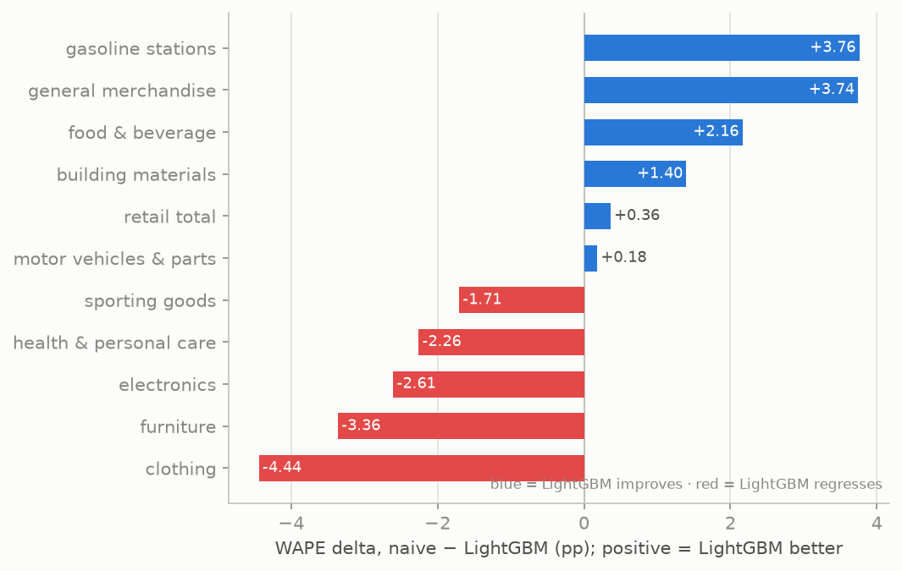
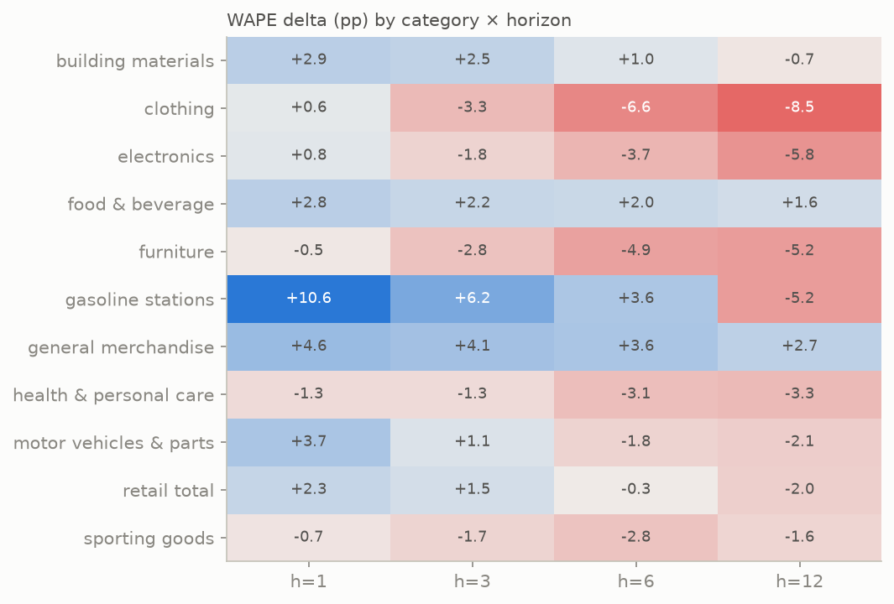
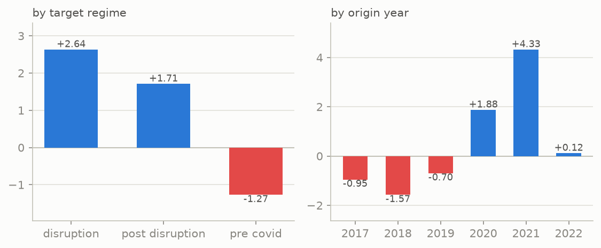
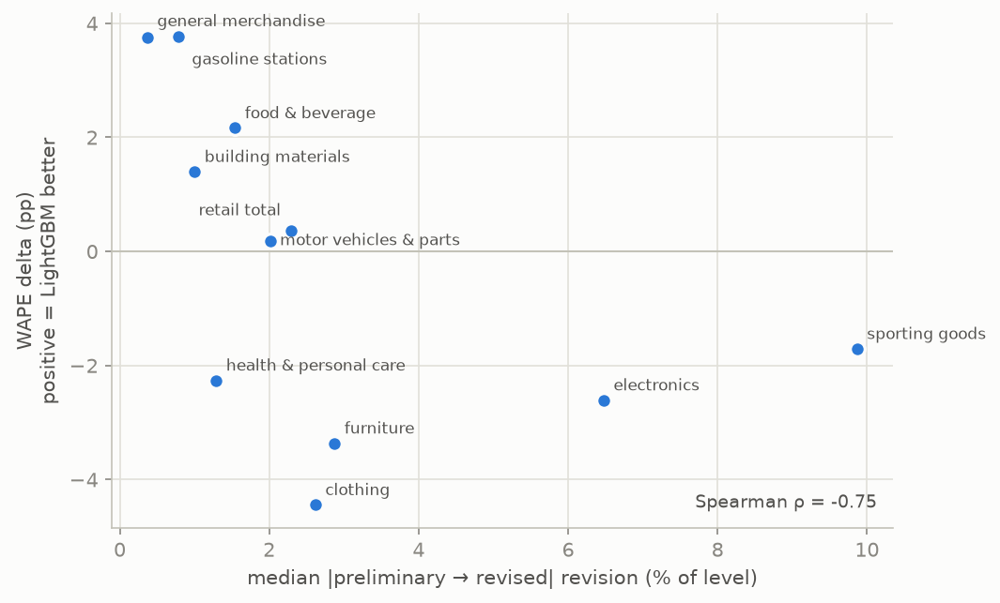

# Error Analysis — where the real-time failure lives

Phase 1 deliverable. Scope: **exploration origins only** (forecast_origin
2017-10 → 2022-10; 24 evaluated monthly origins, 1,056 folds per model). The
2023+ holdout origins present in the frozen artifact were not read here.

Baseline for every number: the failed 2026-11-04 gate, reproduced fold-for-fold
first (see `results/reproduction.json`; naive predictions match the frozen
artifact with max diff **0.0**, LightGBM with max diff **5.8e-11** — CSV
round-trip precision; all 11 per-category deltas match the frozen doc).

## Headline (exploration window)

| Model | Mean category WAPE | Aggregate (pooled) WAPE |
|---|---:|---:|
| Seasonal naive | 9.30% | 6.54% |
| Global LightGBM | 9.55% | **5.87%** |

The gate metric — the unweighted mean of per-category WAPEs — is what failed,
and it fails in every window we can legally inspect. But note the split
personality: pooled across all folds (volume-weighted, dominated by
`retail_total` and other big series), LightGBM is *better* than naive even
under vintage conditions. Its real-time loss is an equal-weighted,
small-category phenomenon, not a uniform defeat.

## 1. The failure is structured, not diffuse

### By category

LightGBM wins 5/11 categories on exploration origins (gasoline +3.76pp,
general merchandise +3.74pp, food & beverage +2.16pp, building materials
+1.40pp, retail total +0.36pp) and loses 6, worst on clothing (−4.44pp),
furniture (−3.36pp), electronics (−2.61pp), health & personal care (−2.26pp),
sporting goods (−1.71pp).

### By category × horizon — the deficit lives at long horizons

| Horizon | naive WAPE | LightGBM WAPE | delta (pp) |
|---:|---:|---:|---:|
| 1 | 7.3% | 4.4% | **+2.91** |
| 3 | 6.8% | 5.1% | **+1.70** |
| 6 | 5.7% | 5.8% | −0.09 |
| 12 | 6.3% | 8.1% | **−1.75** |

LightGBM wins short horizons decisively and loses h=12 just as decisively. The
recursive 12-step rollout compounds whatever noise is in the preliminary
panel-edge: clothing degrades monotonically from +0.6pp (h=1) to **−8.5pp**
(h=12); gasoline flips from **+10.6pp** (h=1) to −5.2pp (h=12).

### By regime and origin year — the gains are all pandemic

| Target regime | delta (pp) | | Origin year | delta (pp) |
|---|---:|---|---|---:|
| disruption (2020-02..2021-05) | **+2.64** | | 2020 | +1.88 |
| post-disruption (> 2021-05) | +1.71 | | 2021 | **+4.33** |
| pre-COVID (≤ 2020-01) | **−1.27** | | 2018 | −1.57 |
| | | | 2019 | −0.70 |

Every point of LightGBM's real-time advantage comes from the pandemic
disruption, where its features let it adapt within months while seasonal naive
carries the year-ago crash forward. In calm regimes (2017–2019 origins,
pre-COVID targets) it *pays* a premium of roughly 1–1.6pp. 2022 origins are a
wash (+0.12pp) — as the regime settled, the advantage evaporated.

### Signed bias

Median signed % error (prediction − actual, % of actual):

| Model | pre-COVID | disruption | post-disruption |
|---|---:|---:|---:|
| seasonal naive | +0.69 | −4.83 | −3.66 |
| global LightGBM | **+3.81** | −0.41 | +3.20 |

In calm periods LightGBM systematically overshoots (+3.8% median vs naive's
+0.7%): consistent with an L1 model on log-ratio targets whose exp-back
recursion drifts high when nothing is forcing it down. During disruption naive
under-shoots the rebound (−4.8%) while LightGBM tracks it — that is exactly its
+2.64pp disruption win.

## 2. LightGBM's regressions overlap the big-revision categories

Median |preliminary → revised| revision magnitude by category (measured on the
vintage panel: value in a month's first archived vintage vs its final value):

| Category | median \|rev\| | p90 \|rev\| | LightGBM delta |
|---|---:|---:|---:|
| sporting goods | 9.87% | 17.49% | −1.71 |
| electronics | 6.48% | 10.11% | −2.61 |
| furniture | 2.88% | 5.72% | −3.36 |
| clothing | 2.62% | 8.35% | −4.44 |
| motor vehicles & parts | 2.01% | 2.97% | +0.18 |
| retail total | 2.29% | 3.12% | +0.36 |
| food & beverage | 1.54% | 2.21% | +2.16 |
| health & personal care | 1.29% | 4.91% | −2.26 |
| building materials | 1.00% | 4.91% | +1.40 |
| gasoline stations | 0.78% | 3.34% | **+3.76** |
| general merchandise | 0.37% | 2.44% | **+3.74** |

**Spearman ρ = −0.755** between category revision magnitude and LightGBM's
delta: the categories it beats are exactly the quietly-published ones; the
categories it loses are the loudly-revised ones. Health & personal care is the
one clear outlier (small revisions, real regression) — revision noise is not
the whole story; variance amplification in volatile-but-stable series matters
too.

The revision *structure* also matters: MRTS seasonal adjustment is re-run
annually on the full history, so published values never permanently settle —
the median month's value is still changing ~190 months later in this archive.
Training on a single vintage keeps the panel internally consistent, but the
recent months that dominate the recursion's feature computation are the least
settled part of it.

## 3. Training staleness cannot explain anything here

The checklist asked to correlate training-panel staleness with error. Measured
fact: **every evaluated exploration origin's as-of window caught a monthly
ALFRED vintage published exactly 2 months after the origin month** (the archive
publishes on the 15th; as-of = month-end + 45 days ≈ the 14th/15th). Staleness
has zero variance on the evaluated grid, so it cannot covary with error. The
gate doc's staleness caveat applies to the 63 *excluded* sparse months, not to
any origin we can evaluate. Nothing was tuned away here — the measurement came
back constant.

## 4. Where the failure lives — synthesis

1. **Long-horizon recursion amplifies preliminary noise.** h=12 is the only
   horizon with a pooled deficit (−1.75pp), and it holds across the losing
   categories. The rollout seeds features from the least-revised months and
   feeds its own drifting predictions back 11 times.
2. **Calm-regime variance premium.** Out of disruption, the model's
   data-adaptive predictions carry +3.8% median overshoot where naive's error
   is nearly symmetric. The equal-weighted gate metric punishes exactly this on
   small volatile categories.
3. **Category revision magnitude ranks the regressions** (ρ = −0.755), with
   health & personal care as the residual outlier.
4. **The aggregate-vs-mean split** (pooled 5.87% < 6.54%, mean-category 9.55% >
   9.30%) shows the model trades small-category accuracy for big-category
   accuracy — a weighting phenomenon the gate metric is designed to catch.

## Ranked hypotheses for Phase 2

1. **H1 — preliminary-noise poisoning** (trim/restrict fit rows to settled
   values, still vintage-safe). Directly motivated by ρ = −0.755 and the h=12
   collapse. Two declared variants: (a) drop fit rows whose value is still
   first-release at as-of; (c) parametric trim of the last k fit-row months,
   k chosen on an inner exploration split (2018–2020 choose, 2021–2022
   report).
2. **H3 — shrinkage toward naive** (forecast combination, per category, Bates
   & Granger 1969; Timmermann 2006). Motivated by the calm/disruptive regime
   split: the two forecasts fail in complementary regimes, and the pooled-vs-
   mean metric split says variance reduction is the lever. Weights chosen on
   the inner split only.
3. **H4 — target transformations** (log-level; year-over-year level diff;
   STL-detrended inputs). Motivated by the pre-COVID overshoot signature
   (log-ratio + exp recursion drift) and h=12 degradation.
4. **H2 — revision-aware features** (revision count/magnitude so far,
   value age, vintage lag, month-of-year revision profile). The model gets
   the same real-time reliability information a human forecaster would have.
   Ranked below H1/H3 because it adds capacity rather than removing a
   demonstrated poison, and below H4 because the failure already has two
   cheaper candidate mechanisms.
5. **H5 — theta method as a third benchmark** (Assimakopoulos & Nikolopoulos
   2000), plus sketches of MIDAS and a small dynamic factor model. If theta
   beats both incumbents on identical origins, the ML stack is the wrong tool,
   not the features.

## Provenance

- Data: `data/alfred_mrts_vintages.csv`, SHA-256
  `b754ac133667eed1dbb6a3e33d2d6a19730bddcbe727d55cb5aa08237a20ec86`
  (byte-identical to the gate input).
- Frozen gate artifact: `reference/vintage_backtest_folds.csv`
  (SHA-256 `ef44397e4fe4263add03dafdf0636ac300dac06d7122b5ef45995b85f6aeb3aa`),
  summary in `reference/vintage_backtest_summary.json`, produced at retailPRED
  revision `f6a769adbfc65faca86aa34cb6160ad4e769427e`.
- Decomposition tables: `results/decomposition.json`,
  `results/decomposition_tables.csv`; reproduction record
  `results/reproduction.json`. Every file carries full provenance.
- Regime boundaries are retailPRED's declared ones (pre-COVID ≤ 2020-02,
  disruption ≤ 2021-06), applied to target months.
